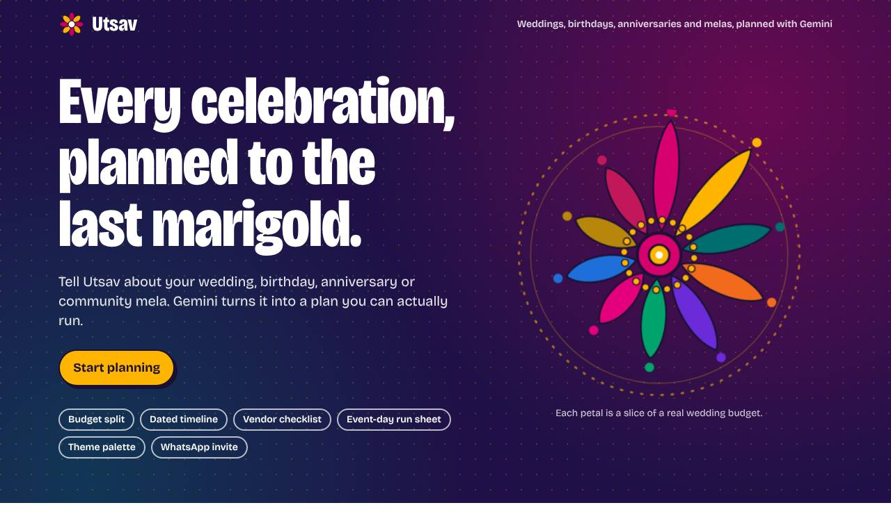
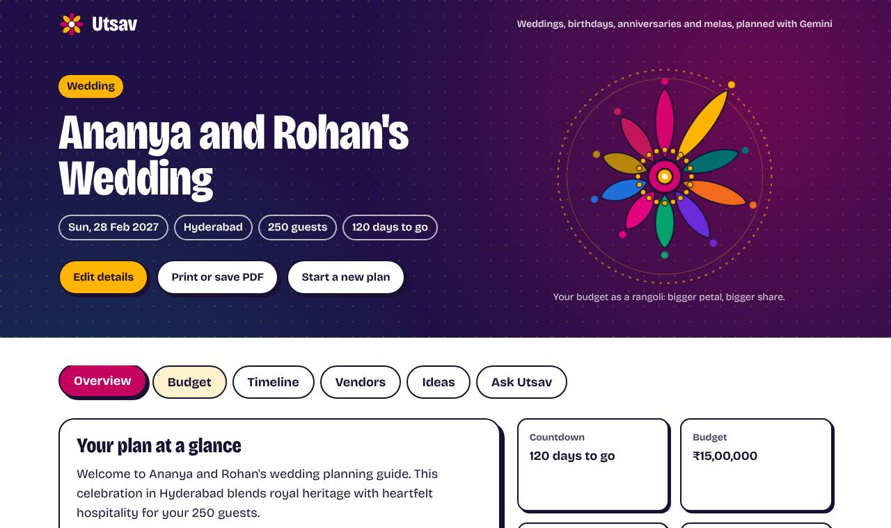
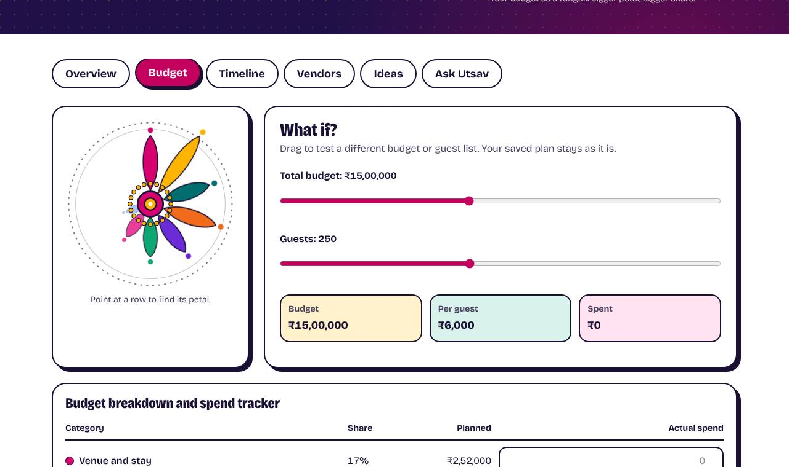
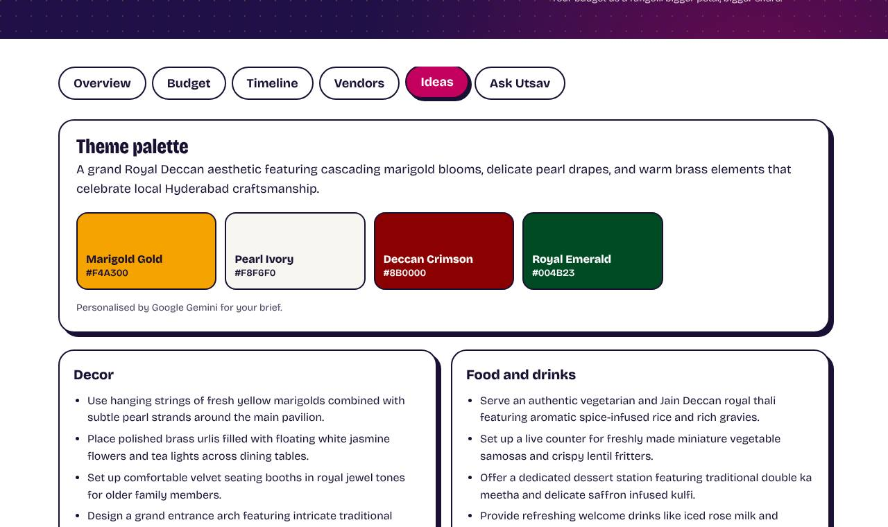

# Utsav: AI Celebration and Event Planner

Utsav is a GenAI planning assistant for **weddings, birthdays, anniversaries and community events**. You describe the celebration in one short form. Utsav returns a complete plan: a **budget split**, a **dated timeline**, a **vendor checklist** and **personalized ideas** from Google Gemini. An assistant answers follow-up questions about that plan.

Built for **PromptWars Virtual, Challenge 5: Celebration and Event Planner**.

- **Live app:** https://utsav-planner-nine.vercel.app
- **Demo video:** https://youtu.be/L5zONBwZaKI
- **Stack:** Next.js 16 (App Router), React 19, TypeScript (strict), Tailwind CSS 4, Zod, Google Gemini (`@google/genai`), Vitest, axe-core

| Plan your event                            | Your plan                                                     | Budget rangoli and what-if                 | Gemini ideas and palette                 |
| ------------------------------------------ | ------------------------------------------------------------- | ------------------------------------------ | ---------------------------------------- |
|  |  |  |  |

## How it meets the challenge

| Challenge asks for                             | What Utsav does                                                                                                                                                                                                                                                                                            |
| ---------------------------------------------- | ---------------------------------------------------------------------------------------------------------------------------------------------------------------------------------------------------------------------------------------------------------------------------------------------------------- |
| Organize weddings, birthdays, community events | Four event types, each with its own budget template, timeline and vendor list. It covers Indian traditions (muhurat, mehendi, sangeet, permits for a mela) without assuming them.                                                                                                                          |
| Budgets                                        | Category split per event type. Up to three priorities (for example food or photography) get a larger share, and the contingency buffer is protected. Amounts always add up to the exact total. Per-guest check with a "tight budget" warning. Planned versus actual spend tracker with over-budget alerts. |
| Timelines                                      | Every milestone is dated back from the event date. If the event is soon, overdue tasks are spread across a catch-up window and marked "Do soon". Exports to `.ics` for Google Calendar, Outlook or Apple Calendar.                                                                                         |
| Vendor checklists                              | Tasks for each vendor (venue, caterer, decorator, photographer, permits, first aid and more). Dietary notes add caterer tasks, accessibility notes (step-free access, wheelchairs, elderly guests) add venue checks, and events over 150 guests add security and parking. Progress is tracked.             |
| Personalized ideas                             | Gemini writes a theme concept, decor, food, activities, saving tips, and up to four extra timeline tasks for your specific brief.                                                                                                                                                                          |
| GenAI assistant                                | "Ask Utsav" chat answers questions about the plan within your budget and currency.                                                                                                                                                                                                                         |

## Architecture

```
Browser (React client)                    Server (Next.js route handlers)
  PlannerForm --zod--> /api/plan  ------>  validate -> rate limit -> buildPlan()
  PlanWorkspace (tabs)                         |-- deterministic: budget, timeline, checklist
  AssistantChat ------> /api/assistant         |-- Gemini: ideas (JSON schema) with an LRU cache
  localStorage (plan + progress)               `-- falls back to curated ideas on any failure
```

**Design decision: the AI never does the arithmetic.** Budget amounts, dates and checklists come from pure, tested functions in `src/lib/planner`. Gemini adds the creative, personal layer (ideas, extra tasks, chat), and its output is validated with Zod before use. As a result, plans are always correct, the app works fully without an API key, and a bad model response cannot corrupt the numbers.

```
src/
  app/                 layout (CSP nonce), page, API routes (plan, assistant, health)
  proxy.ts             per-request nonce Content-Security-Policy
  components/planner/  app shell, brief form, event type and priority pickers, error summary
  components/plan/     plan header and overview, budget (what-if, spend table), timeline,
                       vendors, ideas, assistant
  components/ui/       accessible tabs and form field
  hooks/               usePlanner, useWhatIf, useAssistantChat, validated localStorage state
  lib/planner/         budget, timeline, checklist, ICS, schemas, form state, restore (pure)
  lib/ai/              Gemini client with fallback, prompts, LRU cache, ideas, assistant
  lib/client/          typed fetch wrappers that validate every response
  lib/http/            request pipeline and injectable handlers
  lib/security/        CSP and headers, rate limiter, prompt-injection defense
tests/                 unit, API and component suites (171 tests)
e2e/                   Playwright browser tests with axe, desktop and mobile
docs/                  ARCHITECTURE.md and decision records (docs/adr)
```

## Evaluation criteria

### Code quality

- TypeScript in strict mode with `noUncheckedIndexedAccess`. No `any`, and no type assertions on external data: API responses and local storage are parsed with Zod.
- ESLint with Next.js, TypeScript and the full strict `jsx-a11y` rule set, plus limits on complexity (12), nesting depth, parameters and file length (300 lines). Prettier and `.editorconfig`, checked in CI.
- Small, single-purpose modules: state in hooks (`usePlanner`, `useWhatIf`, `useAssistantChat`), presentational components, and pure domain logic with no I/O. Route handlers are factories with injected dependencies (model, clock, limiter), so they are fully testable.
- One schema (`eventBriefSchema`) validates input on both the client and the server. Every limit is a named constant shared by the form, schema and prompts.
- Structured JSON logging for AI fallbacks, JSDoc on public functions, and [architecture notes with decision records](docs/ARCHITECTURE.md). See [CONTRIBUTING.md](CONTRIBUTING.md).

### Security

- **Input validation:** Zod on every request, text cleaned of control characters, length limits, real-date checks, and past or out-of-range dates rejected.
- **Request pipeline:** same-origin check (blocks cross-site use of the AI quota), per-IP sliding-window rate limits (8 plans and 15 chats per minute), `application/json` only, 32 KB body cap, chat history limited to six turns.
- **Prompt-injection defense:** user text, including earlier chat turns sent back by the browser, is fenced in `<host_input>` tags, and fence tags are stripped so input cannot break out. The system prompt sets an instruction hierarchy, and suspicious phrases are detected and logged. Tested live: "ignore all previous instructions" gets an on-topic refusal.
- **Headers:** nonce-based Content-Security-Policy with `strict-dynamic`, no `unsafe-eval` in production and `frame-src 'none'`, plus HSTS (preload), `Cross-Origin-Opener-Policy`, `Cross-Origin-Resource-Policy`, `X-Frame-Options: DENY`, `nosniff`, `Referrer-Policy` and a locked-down `Permissions-Policy`.
- **Client hardening:** every API response and stored plan is re-validated with Zod and rebuilt, so tampered data cannot inject content or crash the page.
- **Secrets:** `GEMINI_API_KEY` is read only on the server (`server-only` import), is never sent to the browser, and `.env*` files are gitignored. `/api/health` reports only whether AI is on.
- **Dependencies and code scanning:** `npm audit --omit=dev` reports 0 vulnerabilities and runs in CI. CodeQL (security-and-quality) scans every push, and Dependabot keeps npm packages and Actions current.

See [SECURITY.md](SECURITY.md) for the threat model.

### Efficiency

- **Cost control:** `gemini-3.5-flash-lite` (the cheapest current model), minimal thinking, output-token caps (1,800 for ideas, 400 for chat), a 15 s timeout, and one structured JSON call per plan.
- **Caching:** an in-memory LRU cache (200 entries, 30 min TTL) keyed on the whole brief. Repeat briefs return in about 25 ms with no model call.
- **Resilience:** on a 404, 429, 5xx or timeout, the server retries once on a fallback model, and then falls back to curated ideas. If the network fails, the same planner runs in the browser.
- **Lean client:** no chart or UI libraries. The rangoli is hand-built SVG, and the what-if simulator reuses the same pure budget function in the browser. `Intl` formatters are cached, and the bundle stays small.

### Testing

- **171 unit, API and component tests:** 98.6% line and 93% branch coverage (`npm run test:coverage`, thresholds enforced at 90% and 85%).
- **Unit tests:** the proxy CSP, the typed API client (fallbacks, validation, cancellation), restore and progress helpers, form state, error helpers and the logger, plus budget maths (exact sums, priorities, thresholds), timeline compression and leap years, ICS escaping and folding, schemas, cache, rate limiter, prompt defense, and the Gemini client with its fallback chain (SDK mocked).
- **API tests:** validation, 400/403/413/415/422/429 paths, offline and AI modes.
- **Component tests:** restoring tampered or stale saved plans, countdown wording, the what-if simulator, keyboard tab navigation, error summary focus, spend tracker, checklist, calendar export, persistence, network fallback, and chat. Each runs **axe-core** checks.
- **End-to-end:** 10 Playwright scenarios run on desktop and mobile (20 runs) against the production build. They cover the full planning flow, the what-if simulator, persistence across reloads, keyboard-only tabs, offline chat, security headers and API rejection paths, with an axe WCAG 2.1 AA scan on every screen.
- **CI:** GitHub Actions runs audit, format check, lint, typecheck, coverage, build and the end-to-end suite. CodeQL runs alongside.

### Accessibility

- **WCAG 2.1 AA:** a browser audit with axe-core (including colour contrast) finds **zero violations** on every screen, on desktop and mobile.
- Skip link, landmarks, and one `h1` with a logical heading order.
- Forms use real labels, `fieldset` and `legend` for groups, `aria-invalid` and `aria-describedby` for errors, and a focused error summary that links to each field.
- WAI-ARIA tabs with Arrow, Home and End keys. After a plan is generated, focus moves to its title.
- Live regions for status and chat. Budget data is in a real `<table>` with a caption, and vendor progress uses a native `<progress>`.
- Palette swatches pick ink or white text by WCAG luminance, and range inputs announce currency values.
- 44 px touch targets, a visible focus ring, `prefers-reduced-motion` support, and a print stylesheet ("Print or save PDF").

## Run locally

```bash
git clone https://github.com/vedant7007/utsav.git
cd utsav
npm ci
cp .env.example .env.local   # optional: add GEMINI_API_KEY from https://aistudio.google.com/app/apikey
npm run dev                  # http://localhost:3000
```

Without a key, Utsav runs in **offline mode**: budgets, timelines and checklists are complete, and ideas come from curated sets.

```bash
npm run verify   # lint + typecheck + tests with coverage + production build + e2e
```

## Deploy

The app is deployed on Vercel. Set `GEMINI_API_KEY` (and optionally `GEMINI_MODEL`) as environment variables. No database or paid cloud resources are needed. Plans are stored in the user's browser.

## Google services used

- **Google Gemini API** (`@google/genai` SDK, `gemini-3.5-flash-lite` with a lite fallback):
  - structured JSON generation of personalized ideas, extra timeline tasks, a theme palette, an event-day run sheet and a WhatsApp invitation (`src/lib/ai/ideas.ts`)
  - the conversational planning assistant (`src/lib/ai/assistant.ts`, `/api/assistant`)
- Calendar export works with **Google Calendar** through standard `.ics` files.

## License

MIT, by Vedant Manmath Idlgave
